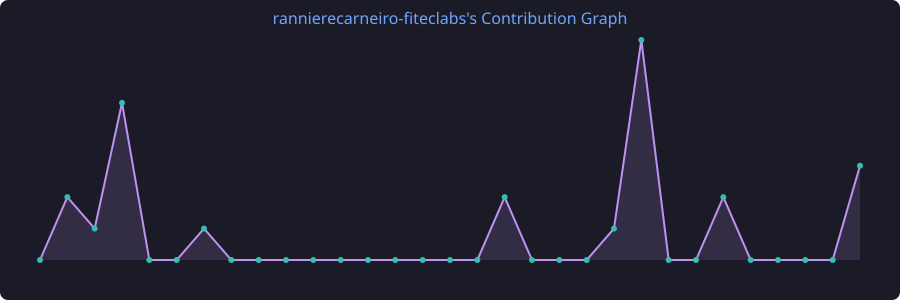

<h1 align="center">⚡ Front-end Specialist</h1>

  

---

Senior Front-end Engineer with 10+ years of experience building scalable and high-performance web applications.

Focused on complex dashboards, refined UX, accessibility, and clean architecture.  
Perfectionist by nature, always aiming for maintainability and visual excellence.

---

## 🎯 What I do best

- Complex dashboards & data visualization (analytics, real-time, data-heavy UI)
- Scalable front-end architecture
- UX refinement & accessibility (a11y)
- Clean, maintainable, and performance-oriented code
- Authentication flows & SSO front-ends (single sign-on, multi-system portals)
- Large-scale refactoring and architecture modernization — Feature-Driven by preference, pragmatic by choice
- Multi-client ecosystems sharing a single API contract (web, admin, mobile)
- Spec-Driven Development & AI-assisted engineering workflows

---

## 🧠 Tech Stack

### 💻 Languages

### ⚛️ Frameworks & Meta-frameworks

### 🧩 UI Libraries

### 🎨 Markup, Styling & Motion

### 📊 Data Visualization

### 🔄 State & Data Fetching

### 🌐 APIs & Real-time

### 📝 Forms & Validation

### 🔐 Authentication

### 🧪 Testing

### 🌍 Internationalization

### ✅ Code Quality & Performance

### 🛠️ Tools & Workflow

### 📐 Methodologies & Architecture
- Feature-Driven Architecture
- Component-Driven Development
- Spec-Driven Development (SDD)
- Scrum
- Kanban

---

## 🏢 Experience

- **Single Sign-On & systems aggregator** — unified login portal integrating multiple internal systems
- **B2B Marketplace** — front-end refactoring to Feature-Driven architecture
- Large-scale projects for global consumer-electronics brands

---

## 📊 GitHub Activity

  

<!-- github-activity:start -->
- Total contributions this year: **1986**
- Current streak: **1 days**
- Longest streak: **6 days**
- Most active day of the week: **Wednesday**
- Average contributions per week: **38**
<!-- github-activity:end -->

## 📈 Contribution Graph

---

## 🎯 About Me

- Building complex dashboards is my playground  
- Passionate about refined UX and accessibility  
- Focused on clean, scalable, and maintainable front-end architecture  

Outside code:
- 🎸 Rock & Metal  
- 🎮 PC Gaming  
- 🎬 Movies, series, anime, and nerd culture  
- ⚽ Soccer  
- 🍺 Beer  

---

## 🌍 Languages
- Portuguese — Native  
- English — Professional working proficiency  

---

> *"Good UI is invisible. Great UI feels natural."*

`ØrkümL`
